# 24帧杂志排版

24帧杂志排版是 24FRAMES PROJECT 排公众号长文用的技能。你写一份 `article.md`，把图片放好，它会生成可以直接贴进公众号后台的正文 HTML、横版和方版两张封面，然后在三种手机宽度下截图自检。需要的话还能把文章存进公众号草稿箱。所有脚本都不会发布或群发文章。

适合影评、导演回顾、游戏评论这类图文长文。`example/` 里是李沧东《可能的爱》的完整例稿，已发布的效果见[《爱，究竟还有没有可能？》](https://mp.weixin.qq.com/s/UGpz2XrDQ0yVFguU72gWog)，可以先跑一遍例稿对照。

## 一键安装

支持 Agent Skills 的工具（Claude Code、Cursor、Codex、OpenCode 等）都可以装：

```bash
npx skills add 24frames-film/24frames-oa-kit
```

加 `-g` 装到全局，加 `-a claude-code` 只装给指定的工具。需要 Node.js 22.20 或更高版本。

装好以后，对 agent 说「24帧杂志排版，排这篇」，再把文稿和图片给它就行。

## 装好后能做什么

- **正文排版**：章节标题、dek（头图下的导语）、图注、上下对图、侧栏条目、音乐卡片、署名、credits、页脚和「Read more」卡片，按统一的字号、间距和颜色生成。
- **封面**：同时出 1800×766 横版和 1080×1080 方版，logo 的大小和位置都按规格摆好。
- **深色模式**：整篇文章铺一层白底，读者切到深色模式时阅读区仍然是白底黑字，在后台编辑器里也照常能改。
- **二维码**：三个二维码各是一张单独的图片，长按都能识别。
- **自检**：检查 347、383、677 三种宽度下的边距、间距、字号，以及有没有描图生成的文字。全部通过才算完成。
- **存草稿（可选）**：每篇只新建一次草稿，之后只更新这一份，不会覆盖你在后台编辑器里手动改过的内容。

## 排版部件一览

下面是一篇文章从上到下会出现的全部部件。预览图用 `example/` 里的例稿生成（李沧东《可能的爱》，已发布效果见[《爱，究竟还有没有可能？》](https://mp.weixin.qq.com/s/UGpz2XrDQ0yVFguU72gWog)），手机宽度 383px。核对排好或已发布的文章时，可以按这个顺序逐项对照，看有没有缺漏。页脚 logo 之后的部分由脚本自动生成，不用写在 `article.md` 里。

| # | 部件 | `article.md` 写法 | 规格 | 预览 |
|---|---|---|---|---|
| 01 | 刊头 | 自动生成；frontmatter `cover_label` 决定括号里的栏目词（Screen / Play / Portrait） | `assets/masthead.svg`：官方 logo + Screen / Play / Portrait 行，当前栏目加「」，栏宽 100%。文章顶 → logo 24px，刊头 → 头图 32px | 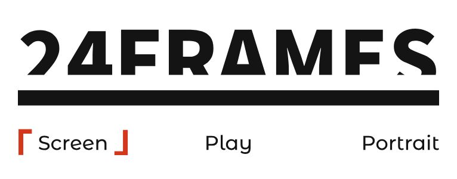 |
| 02 | 头图 | frontmatter `hero: images/….jpg` | 内容图宽 ≥1080。头图 → dek 24px |  |
| 03 | dek（导语） | `### …` | 12px / 300 / 行高 1.8 / 字距 1px，`#D3381C` | 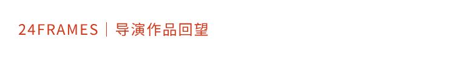 |
| 04 | 正文 | 普通段落；`**粗体**` 加粗 | 14px / 300 / 行高 1.8 / 字距 1.5px，两端对齐，无首行缩进，`#3E3E3E` | 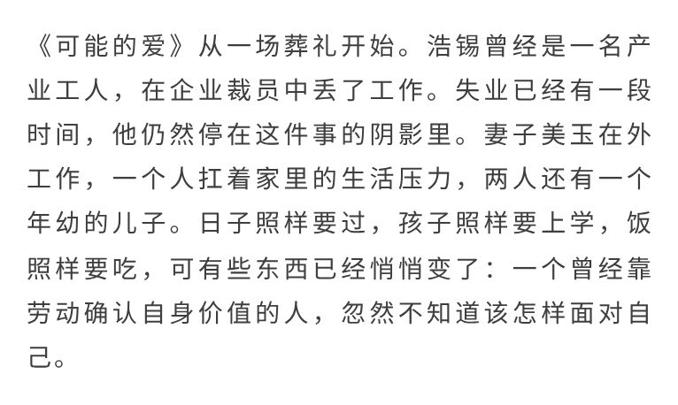 |
| 05 | 章节词标 01–NN | `## 01 中文标题 \| ENGLISH` | 编号 Bebas Neue，英文 Montserrat Alternates SemiBold 加「」，中文 Noto Sans CJK SC Bold；中文约 18 字一行，放不下报错。上下各 48px | 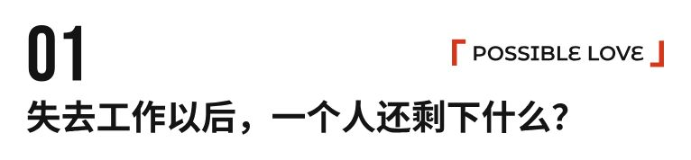 |
| 06 | 单图 + 图注 | `` | 图 → 图注 16px；图注 12px `#D3381C`。影片剧照图注只写 `《片名》年份` | 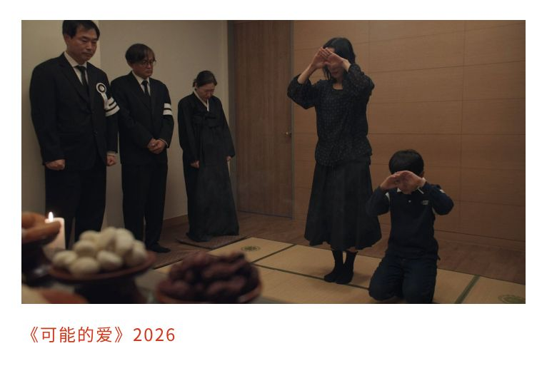 |
| 07 | 上下对图 | `` | 两张图上下排，间隔 4px，图注在下方；多条图注用 ` // ` 隔开，每条一行 | 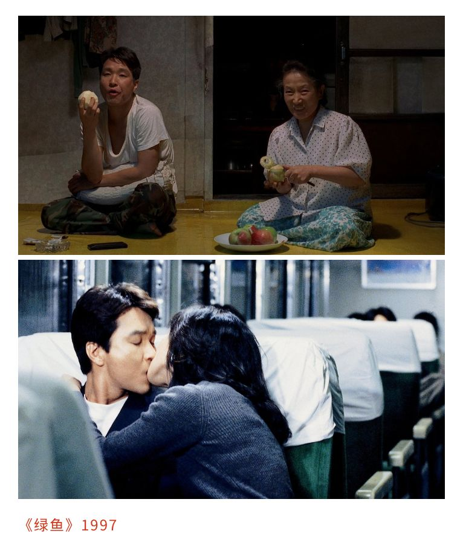 |
| 08 | GIF | 同单图，文件用 `.gif` | 排版和单图相同。GIF 宽 ≥480 | 同 06 |
| 09 | 侧栏条目（rail） | `>> **起头词**文字` | 字号同正文，宽 85%、左缩 15%，起头词 600 绯红；同组条目之间 24px |  |
| 10 | 音乐卡片 | `[[music-card]]`，放在一段正文后；frontmatter 填 `music_*` 字段 | 前一段末尾自动加「（请点击音乐继续阅读）」。卡片本身（`mp-common-clmusic`）只在公众号里显示，预览图里的灰条是占位 | 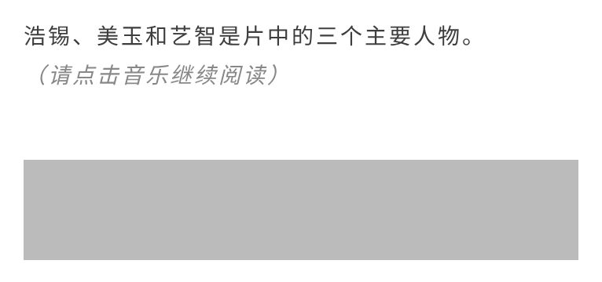 |
| 11 | ♪ 音乐行 | `♪ …` | 12px `#D3381C` |  |
| 12 | 署名块 | `[[byline]]`；frontmatter `byline_name`、`byline_sig` | 「24帧/文」→ 名字 → 个签，间距 16px；个签 12px `#999999`。署名块前后 48px |  |
| 13 | credits | `[credit] …`，可写多行 | 12px `#3E3E3E`，统一放在署名块后面 | 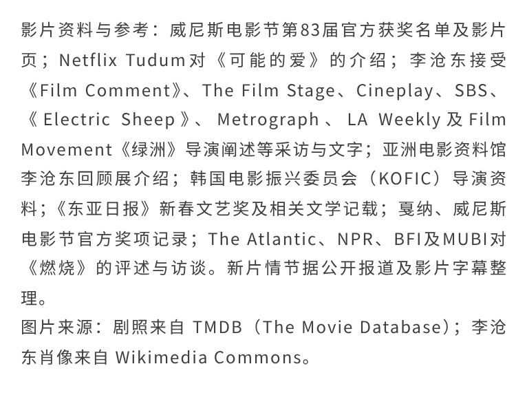 |
| 14 | 页脚 logo | 自动生成 | `assets/footer.svg`：只有 logo，无底色、无卡片 | 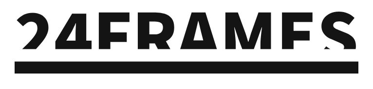 |
| 15 | Read more 标题 + 卡片 | 自动生成；frontmatter `readmore_url`、`readmore_title`、`readmore_cover` | 上一篇的 2.35:1 封面放大到 1218 宽，底部渐变，白色标题；整张可点击 |  |
| 16 | Follow us 标题 + 三个二维码 | 自动生成 | `assets/qr_oa.png`、`qr_xhs.png`、`qr_helper.png`，540×540，三张独立图片，宽 26.656%，间距 10.016%，长按各自识别 |  |
| 17 | 横版封面 | `make.py --cover`；frontmatter `cover_still`、`cover_label` | 1800×766，亮度 0.72，白色 logo 墨迹宽 518 居中，栏目词 Montserrat Alternates Medium 44 加「」 | 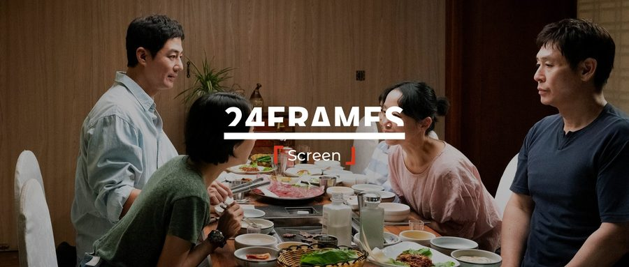 |
| 18 | 方版封面 | 同上，一起生成 | 1080×1080 | 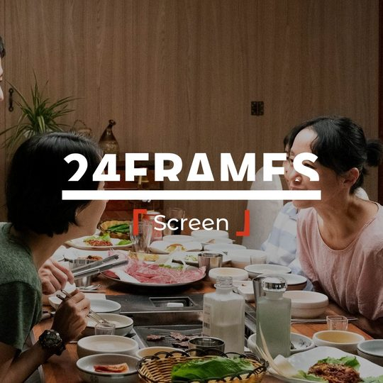 |

例稿里没有侧栏条目、音乐卡片和 ♪ 音乐行，这三张预览图是在例稿里临时加了几行写法生成的。

<details>
<summary>整篇长图（例稿，缩小显示）</summary>


</details>

## 写一篇文章

```bash
python3 skills/24frames-magazine-layout/bin/new_article.py ~/oa/my-article    # 新建文章目录
# 编辑 ~/oa/my-article/article.md，图片放进 images/
python3 skills/24frames-magazine-layout/bin/make.py ~/oa/my-article --cover    # 生成正文和封面
python3 skills/24frames-magazine-layout/bin/selfcheck.py ~/oa/my-article --shots   # 自检，必须全部 PASS
```

生成的文件都在文章目录的 `out/` 下，正文是 `out/content.html`，封面在 `out/cover/`。

`article.md` 每行的写法：

| 写法 | 生成 |
|---|---|
| `### …` | dek，头图下面的 12px 绯红导语 |
| 普通段落、`**粗体**` | 14px 正文 |
| `## 01 中文标题 \| ENGLISH` | 章节标题，中文最好不超过 18 个字 |
| `` | 单张图加图注 |
| `` | 上下两张图 |
| `>> **词**文字` | 侧栏条目 |
| `[[music-card]]` / `♪ …` | 音乐卡片 / 音乐行 |
| `[[byline]]` / `[credit] …` | 署名块 / credits |

文章开头的 frontmatter 字段见 `templates/article_template.md`。

## 运行环境

```bash
pip install -r skills/24frames-magazine-layout/requirements.txt
python3 -m playwright install chromium     # 已装 Chrome 的话，设 CHROME_PATH 指向它也可以
```

中文字体用思源黑体（Noto Sans CJK SC，`NotoSansCJK-Bold.ttc` 和 `NotoSansCJK-Regular.ttc`）。脚本会在常见的字体目录里找，找不到时用 `OA_CJK_BOLD`、`OA_CJK_REGULAR` 两个环境变量指向字体文件。

## 公众号凭据（只有存草稿时需要）

两种方式选一种，凭据不要放进仓库：

```bash
export WECHAT_APPID=...          # 公众号 AppID
export WECHAT_APPSECRET=...      # 公众号 AppSecret
# 或者写在一个文件里：
export WECHAT_ENV_FILE=~/.config/24frames-magazine-layout/wechat.env   # 文件里写 WECHAT_APPID=… 和 WECHAT_APPSECRET=… 两行
```

token 默认缓存在 `~/.cache/24frames-magazine-layout/wechat_token.json`，可以用 `WECHAT_TOKEN_CACHE` 改位置。运行脚本的电脑的出口 IP 要先加进公众号后台的 IP 白名单。

存草稿的命令：

```bash
python3 skills/24frames-magazine-layout/bin/draft.py ~/oa/my-article dry-run          # 只检查，不调用接口
python3 skills/24frames-magazine-layout/bin/draft.py ~/oa/my-article add --yes-add    # 真正新建草稿，每篇只跑一次
python3 skills/24frames-magazine-layout/bin/preview_verify.py ~/oa/my-article         # 在预览页核对浅色和深色模式
```

## 先跑一下例稿

```bash
cp -r skills/24frames-magazine-layout/example /tmp/demo
python3 skills/24frames-magazine-layout/bin/make.py /tmp/demo --cover
python3 skills/24frames-magazine-layout/bin/selfcheck.py /tmp/demo --shots
```

## 换成你自己的公众号

仓库里的 logo 和二维码是 24帧 的。用在自己的号上时：

1. 替换 `logo/24frames_official.svg` 和 `assets/qr_*.png`。
2. 改 `skills/24frames-magazine-layout/bin/textsvg.py` 里的标签文字，再运行 `python3 skills/24frames-magazine-layout/bin/textsvg.py strips` 重新生成文字 SVG（`skills/24frames-magazine-layout/docs/SPEC.md` 第 7 节有说明）。
3. 颜色、字体、版式参数都在 `kit.json` 里改。

## 目录

```
skills/24frames-magazine-layout/
  SKILL.md        给 agent 看的流程和规则
  README.md       本说明
  docs/           SPEC.md 排版规格，WRITING.md 写作规范
  bin/ lib/       脚本
  kit.json        颜色、字体、版式、接口白名单
  assets/ logo/ fonts/ templates/ vendor/
  example/        李沧东《可能的爱》例稿
```

## 安全

- 脚本只能新建和更新草稿，发布、群发、删除草稿这几个接口都在 `lib/wechat.py` 里拦掉了。
- 凭据和 token 不会被打印出来，也不会被提交进仓库。

## 授权

字体 Bebas Neue 和 Montserrat Alternates 以 SIL OFL 1.1 授权（见 `fonts/OFL.txt`），`vendor/mp-darkmode` 是 MIT 授权。
